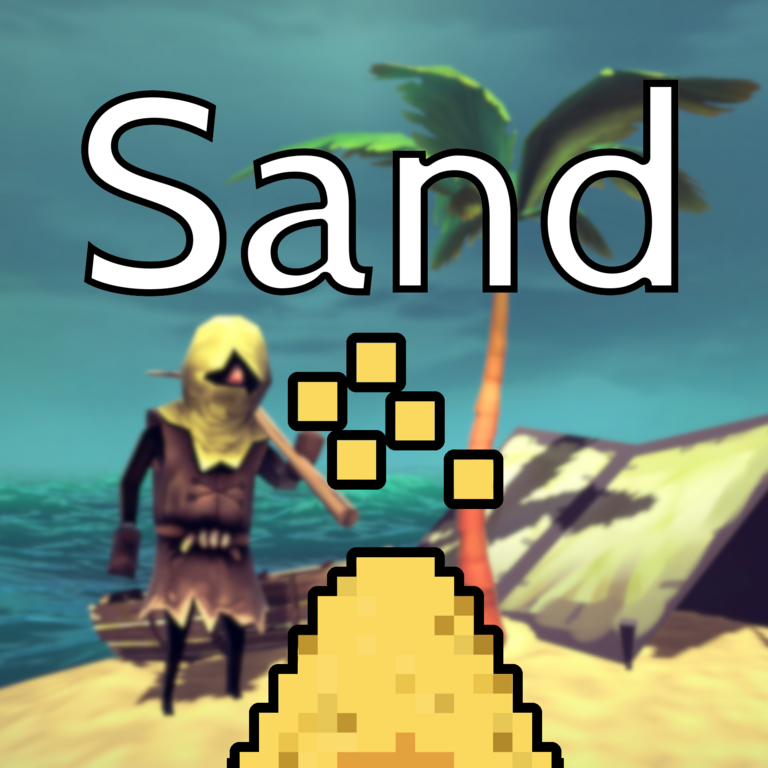
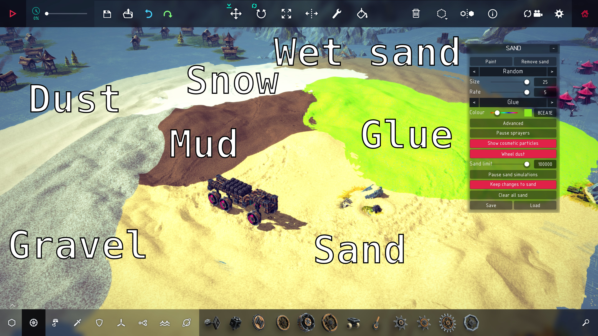
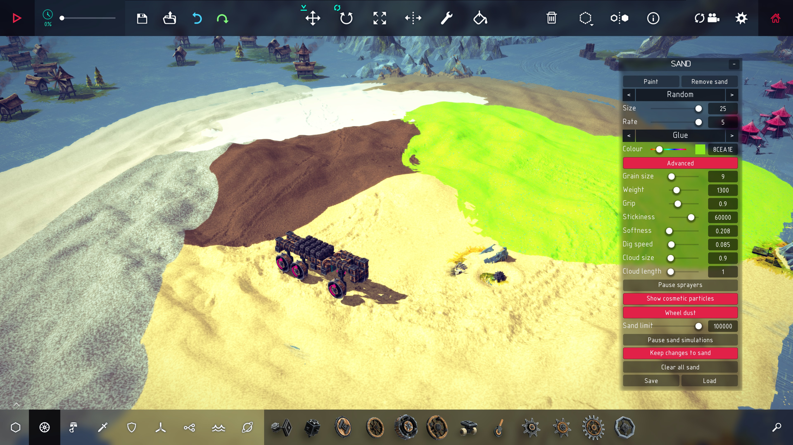
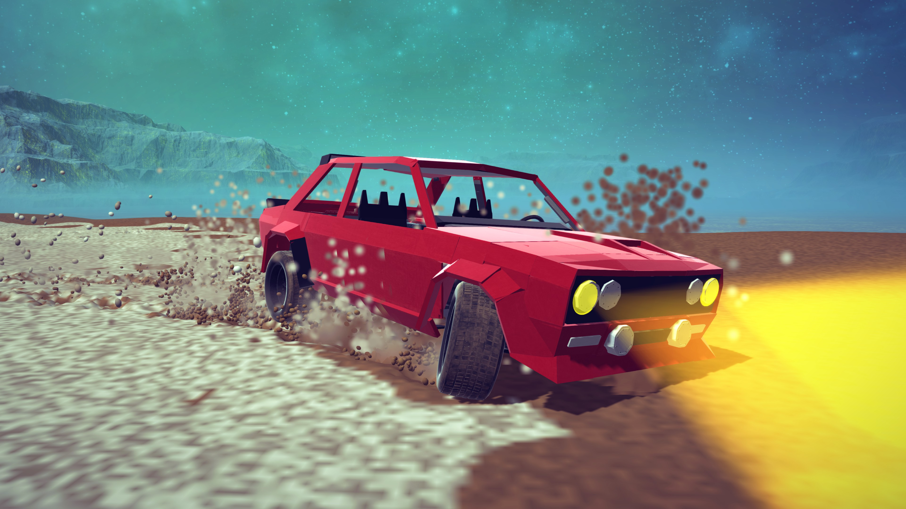
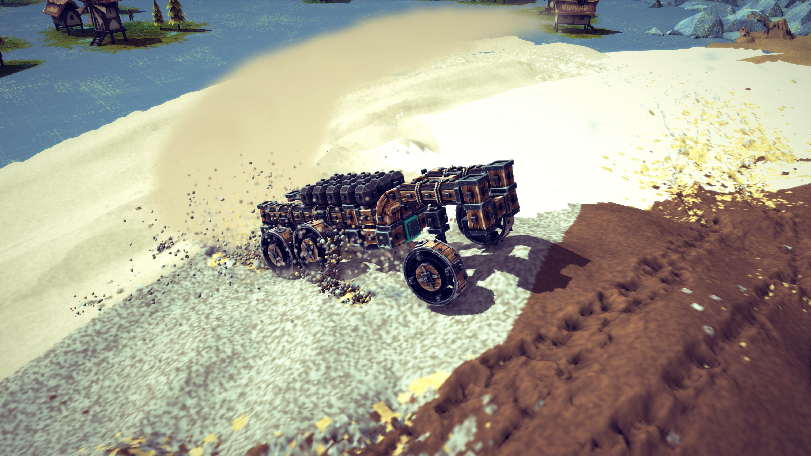
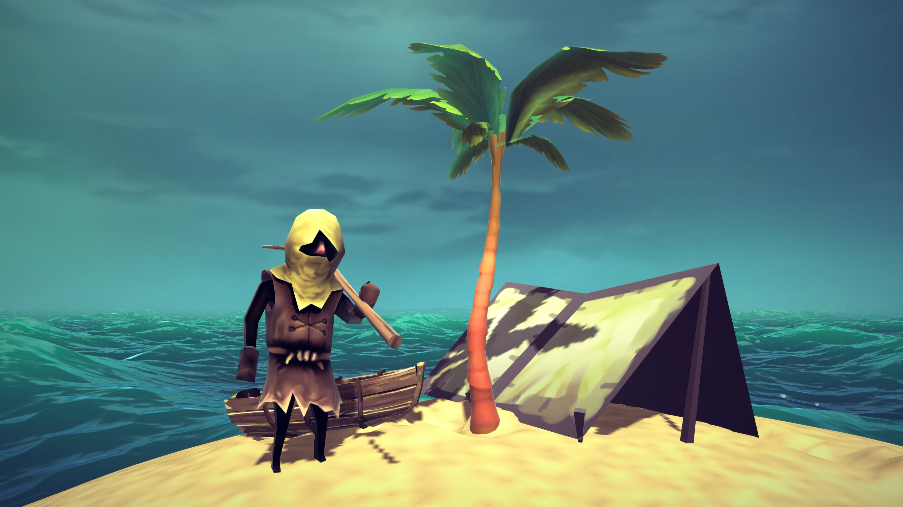

# Besiege Sand



Sand for [Besiege](https://store.steampowered.com/app/346010/Besiege/).
Multiple materials available with different behaviors and looks: sand, wet sand, dust, snow, gravel, mud and glue.
You can use the built-in paint tool to place the materials in any Besiege level.
Machines drive on it and their wheels press ruts into it, blades plough it aside, and explosions blow craters in it.
Spinning wheels, sliding blocks and explosions throw up a spray of sand that is only drawn, and wheels raise dust clouds.

Sand is saved just like a Besiege machine but in its own `Sand_mod` folder and with a different screenshot (taken from the top down to see the sand placed on the ground better).
To save or load you should use the buttons on the mod's UI/HUD (see the screenshots below).

**[UI Factory](https://steamcommunity.com/sharedfiles/filedetails/?id=2913469777)** (workshop item `2913469777`) is strongly recommended.
Without it the sand panel is a plainer one, but everything should still work.

<br clear="right">

## Install

Either subscribe to the mod on Steam, or if you don't use Steam you can clone the repo then:

```sh
./tools/install.sh              # symlink into Besiege_Data/Mods
./tools/install.sh --copy       # copy instead
./tools/install.sh --uninstall
```

Set `BESIEGE_DIR` if your install isn't found automatically. Start Besiege, enable **Sand** in the mods menu, and the sand panel appears in the top-right corner. No C# toolchain is needed; the build uses Besiege's own compiler.

## Available materials



| Material | What it does |
| --- | --- |
| **Sand** | Dry and loose: pours into piles at its angle of repose and slides off a wheel |
| **Wet sand** | Heavier, holds steeper slopes, clings a little |
| **Dust** | Fine and light, spreads flat and hangs in the air in big clouds |
| **Snow** | Light and soft, packs down under wheels and sticks to them |
| **Gravel** | Big heavy stones, hard to dig and quick to settle |
| **Mud** | Heavy and sticky, wheels sink and pick it up |
| **Glue** | Very sticky: it clings to whatever touches it |

Every medium can be any colour, and with **Advanced** its own behaviour can be changed for the brush without changing the medium anywhere else.

## Options available to the player



The panel folds away into a small sand-pile icon with the **-** button in its top bar, and the icon can be dragged anywhere.

| Control | What it does |
| --- | --- |
| **Paint** / **Remove sand** | Hold the left mouse button over the level to paint sand, or to remove it |
| (the brush) | The brush's shape: circle, flat circle, square, random, ring |
| **Size** / **Rate** | How wide the brush is, and how fast it pours |
| (the material) | Which material the brush pours |
| **Colour** | Its colour, with a box for a hex code |
| **Advanced** | The material's own numbers for the brush: grip (its angle of repose: how steep it piles and how steep a track's walls stay), softness (how easily it presses), dig speed (how fast a blade must move to plough it, and a wheel slip to throw spray), rut depth (the deepest a wheel compacts it), fill speed (how fast tracks and holes slide back in), and the size and length of the dust clouds wheels raise from it |
| **Show cosmetic particles** | A spray of fine grains that is only drawn, from wheels and blocks slipping on or landing on the sand, and from explosions. Costs almost nothing |
| **Wheel dust** | Clouds of dust raised by wheels on the sand, in the colour of the sand under them |
| **Pause sand simulations** | Freezes the sand: machines still drive on it as on solid ground, but nothing presses, ploughs or slumps |
| **Keep changes to sand** | Keeps what the simulation did to the sand when it stops, instead of putting it back as it was |
| **Clear all sand** | Removes all the sand, after asking |
| **Save** / **Load** | Saves the sand on its own, or loads it (see [Saving](#saving)) |

Every brush stroke, every **Clear all sand** and every sand load is one step in Besiege's own undo history, so the game's undo and redo buttons and keys work on the sand and the machine together.

The panel remembers its settings between runs of the game.

## Multiplayer

The host simulates the sand and sends it to everyone, so every player sees the same sand.
Each player draws their own cosmetic particles and wheel dust.

The host's settings are greyed out on everyone else's panel.
The host can let other players load sand files with **Allow others to load sand**, and let them paint with **Other players place sand**.

## Notes

- **Performance**: sand that nothing touches costs almost nothing, so a whole level can be covered. Turn on **Pause sand simulations** for sand that only needs to be driven on, or turn off **Show cosmetic particles** and **Wheel dust** if a scene runs slowly.

## Gallery








## Building and testing

```sh
./tools/build.sh                 # compile with Besiege's own compiler and check against the mod loader's blacklist
./tools/verify-build.sh          # compile and check without writing the assembly
./tools/test-bed.sh              # the headless tests, no game needed
./tools/make-icon.sh             # the sand panel's folded icon, drawn from Sand/Scripts/SandIcon.cs
./tools/make-thumbnail.sh        # copy Thumbnail_2.png into the mod as its Workshop picture
```

The build needs **UI Factory** installed, because the panel is built from its prefabs. Set `UIFACTORY_DIR` if it is not found.

[docs/DESIGN.md](docs/DESIGN.md) has how the sand works and the measurements behind each decision, and [docs/PERFORMANCE.md](docs/PERFORMANCE.md) where the frame rate goes. The general notes on Besiege's modding API, for a mod that is not this one, are collected in [Besiege-Modding-AI-notes](https://github.com/anton-scholten/Besiege-Modding-AI-notes).

## Licence

GPL-3.0. Besiege is Spiderling Studios'; nothing of theirs is redistributed here.
